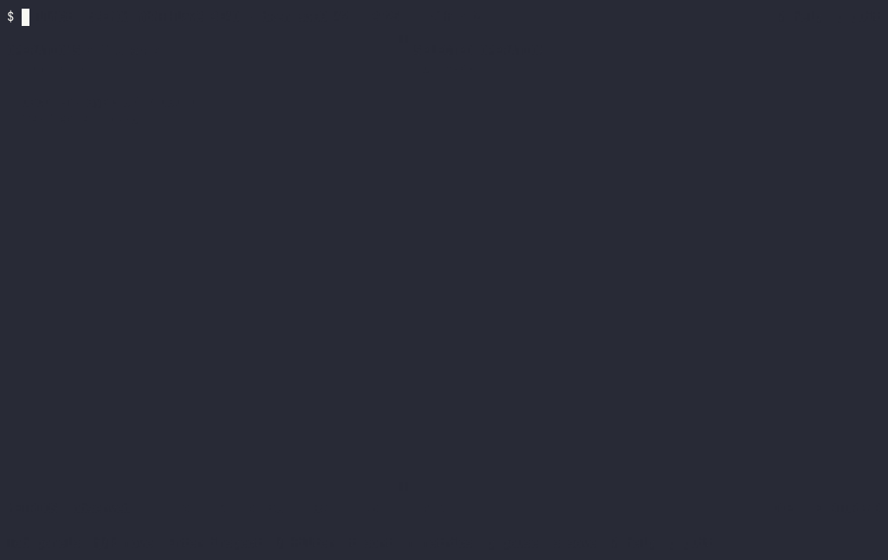

# llm-trace

A lightweight, local-first instrumentation, tracing, and replay platform for transformer inference, written in C++17 with a keyboard-driven terminal UI.

[](docs/media/demo.mp4)

*Recorded with asciinema in a 120×32 terminal on a Linux VM (release build). Shown: the synthetic `[DEMO]` trace filling a 2,000-event buffer (overwrite counter visible), inspecting, filtering, saving, replaying the saved file, then opening a real ONNX Runtime 1.20.1 profile. [MP4](docs/media/demo.mp4)*

> **Status:** MVP (0.1.0). It provides:
> - a C++17 core: event model, bounded ring buffer, collector, aggregation
> - a keyboard-driven TUI
> - a deterministic synthetic demo
> - JSONL save and offline replay
> - an ONNX Runtime profile-file adapter
>
> There is no live capture from a real runtime yet. ONNX Runtime data is read from its profile file after the run.

## Build

Requirements: CMake 3.20+, a C++17 compiler (GCC 11+, Clang 14+ or Visual Studio 2022), Ninja on Linux. Dependencies are fetched and pinned by CMake.

Linux:

```bash
cmake --preset debug
cmake --build --preset debug
ctest --preset debug
./build/debug/llm-trace --help
```

Windows (PowerShell, Visual Studio 2022):

```powershell
cmake --preset msvc
cmake --build --preset msvc-release
ctest --preset msvc-release
.\build\msvc\Release\llm-trace.exe --help
```

## Synthetic demo

```bash
./build/debug/llm-trace --demo            # Windows: .\build\msvc\Debug\llm-trace.exe --demo
./build/debug/llm-trace --demo --no-color --ascii
./build/debug/llm-trace --demo --print-frame 120x40   # print one frame and exit
```

The demo trace is deterministic for a given `--seed`. Its timings come from a fixed cost model, **not from a real model**. The TUI marks it `[DEMO]` / `SYNTHETIC DEMO` at all times, and attention values and activation summaries are reported as "Not exposed by adapter".

Keys: `j`/`k` or arrows move, `Tab` switches panel, `Enter` inspects, `/` filters (see [Filtering](#filtering)), `t` cycles the sort order, `m` shows metrics, `p` pauses the view while capture continues, `s` saves, `?` shows help, `q` quits. Layouts: two panes at 110+ columns, a compact two-pane view at 80–109, and a single pane below 80 columns.

### Filtering

Press `/` and type terms separated by spaces; an event must match all of them. The view updates as you type. If a term does not parse, the list keeps the last valid result and the error is shown next to the filter.

| Term | Matches |
|---|---|
| `matmul` | case-insensitive substring of name, category, event type or op type; a bare number such as `3` also matches layer 3 |
| `"layer.0 attn"` | quotes keep spaces inside one term |
| `name:qkv`, `op:MatMul`, `device:cpu` | case-insensitive substring of that field |
| `cat:attention`, `type:warning` | exact category or event type |
| `layer:3`, `layer:2..5`, `layer>=10`, `token:0`, `head<4` | integer comparisons (`:` `=` `<` `<=` `>` `>=`, `a..b` inclusive) |
| `dur>50us`, `dur<=1.5ms`, `dur:10us..2ms` | duration with a unit: `ns`, `us`, `ms`, `s` |
| `op:missing`, `dur:missing`, `layer:missing` | the event does not carry that field |
| `-cat:session` | a leading `-` negates any term |

An event that lacks a field never satisfies a comparison on it: `dur<1us` does not match events without a duration (use `dur:missing` for those). Unknown keys such as `lyer:3` are reported as errors rather than treated as text. At most 16 terms.

## Save and replay

```bash
./build/debug/llm-trace --demo --output demo.jsonl   # saves on exit; press s to save at any time
./build/debug/llm-trace --open demo.jsonl            # offline replay, no model or adapter needed
```

Traces are versioned JSON Lines ([format](docs/architecture/event-schema.md)). Files are written to a temporary file and then renamed, so an interrupted save never truncates an existing trace. Imported files are validated against size and structure limits. A malformed file is rejected with its line number, e.g. `cannot load bad.jsonl: line 3: not valid JSON`. A replayed synthetic trace is still labelled `[DEMO]`. Nothing is uploaded: files are only read from and written to the paths you give.

## ONNX Runtime profiles

```bash
llm-trace --open onnxruntime_profile_2026-01-01_12-00-00.json
```

This reads the profile ONNX Runtime writes when profiling is enabled (tested with 1.20.1). It shows per-kernel timing, op type, provider and input/output shapes. ONNX Runtime profiles contain no tensor values, so attention and activation data are shown as unavailable. Profiling itself slows inference down: about 6.8x on the tiny test model, where per-node overhead dominates. See [docs/adapters/onnxruntime.md](docs/adapters/onnxruntime.md) for the field mapping, how to produce a profile, and the overhead measurement.

## What it does not do

- It does not show attention weights, activation statistics or token positions for ONNX Runtime. The profile doesn't contain them, so the UI says "Not exposed by adapter" rather than guessing.
- Synthetic demo timings are a cost model, not measurements.
- There is no live hook into a runtime and no GPU-specific data. Only the CPU execution provider has been tested.
- There is no network access and no telemetry. It reads and writes only the files you name.

## Comparing two traces

```bash
llm-trace --compare before.jsonl after.jsonl            # or two ONNX Runtime profiles
llm-trace --compare a.json b.json --compare-by op --compare-json diff.json
```

The report shows the mean time per call for B against A, by category, by layer and by operation, plus ops that appear in only one trace. It warns when the traces differ in source, model, runtime or device, or when either trace lost events. It does not test significance. Details and a measured example: [docs/compare/](docs/compare/).

## Performance

`llm_trace_bench` measures llm-trace's own costs (release build, 8 vCPU Xeon VM):
- storing an event: about 0.2 µs (about 0.86 µs per event with 4 threads contending, 0.64–0.74 µs using `submit_batch`)
- saving: about 6 µs per event
- loading with full validation: about 11 µs per event
- a live refresh with a full 65,536-event buffer: about 3 ms (it was about 30 ms before M6)
- opening and drawing a 65,536-event replay: about 28 ms, once

These are not end-to-end overheads on a real model. Method, full numbers and caveats are in [docs/benchmarks/](docs/benchmarks/).

## Documentation

- [Architecture overview](docs/architecture/overview.md) and [decision records](docs/architecture/decisions/)
- [Trace file format](docs/architecture/event-schema.md)
- [ONNX Runtime adapter](docs/adapters/onnxruntime.md)
- [Comparing traces](docs/compare/)
- [Benchmarks](docs/benchmarks/)
- [Contributing](CONTRIBUTING.md)

## License

MIT — see [LICENSE](LICENSE).
